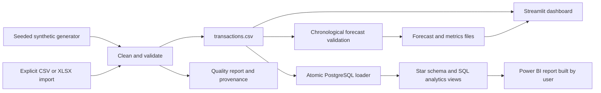

# Architecture

RetailPulse keeps computation in ordinary Python functions and publishes transparent CSV/JSON artifacts. The dashboard and warehouse consume the same cleaned transaction data, making metrics straightforward to reconcile.

## Boundaries

- `pipeline.py` owns input mapping, cleaning policy, reproducible generation, output files and source labeling. Input validation rejects unusable data before downstream reporting.
- `forecast.py` owns a daily aggregate series and time-ordered validation. It does not mutate transaction data.
- `database.py` validates its input independently, uses Psycopg COPY into a temporary staging table, then replaces only the project schema's tables inside a transaction. Failures roll back. An advisory lock serializes project loaders.
- `dashboard.py` reads file outputs. It has no database write path. Filters alter displayed analysis, not the trained forecast files.
- SQL views define reusable business analyses. Power BI consumes the star schema and requires separate Desktop verification.

## Reproducibility

The demo fixes a random seed and calendar. Cleaning sorts outputs stably. Forecast folds use explicit dates, not today's date or random splits. The manifest hashes input/cleaned files. SQL RFM anchors recency to the last observed date. Dependencies have bounded versions; strict replay across machines should also retain the installed package list and interpreter version.

## Verification design

Unit tests isolate cleaning, generation, forecast leakage boundaries and numeric definitions. Streamlit AppTest checks page execution and filters. Live PostgreSQL tests exercise exact revenue, repeat loading, zero-sales dates, all analytics views, constraints and rollback. CI creates a disposable PostgreSQL service. Actual local execution and any gaps belong in `verification.md`.

## Deliberate limits

This is a local batch portfolio project, not a POS system, online feature store or shared production service. Snapshot loads intentionally replace the project's current dataset. The v1 idempotent DDL is not a migration framework. There is no real inventory/cost integration, authentication, production deployment, or native PBIX artifact. These require actual sources and a separate operational contract.
